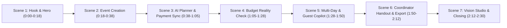

# UtsavAI — Challenge 5 Demo Video Storyboard

**Project:** UtsavAI — The Celebration Copilot  
**Competition:** Hack2Skill PromptWars Virtual Challenge 5 (Celebration & Event Planner)  
**Target Duration:** 2 minutes 30 seconds (150 seconds)  
**Theme:** Editorial Luxury (Midnight Plum `#0C0914`, Rose-Pink `#EF7187`, Lavender `#9782E8`, Serif Typography)  
**Audio:** Confident, warm, professional voiceover with ambient acoustic soundtrack at 15% volume  

---

## Scene Overview & Timeline Matrix

| Scene | Duration | Route | Focus Capability | Key Visual Element |
| :--- | :--- | :--- | :--- | :--- |
| **Scene 1** | 0:00 - 0:18 (18s) | `/` | Luxury Brand & Problem Statement | Cinematic video hero, Cormorant Garamond typography, theme toggle |
| **Scene 2** | 0:18 - 0:38 (20s) | `/wizard` | Occasion-Tailored Event Wizard | 5-step wizard, uncapped priorities, ceremony selection |
| **Scene 3** | 0:38 - 1:05 (27s) | `/planner` | Conversational AI & Payment Ledger Sync | Natural language payment recording, action card, ledger balance update |
| **Scene 4** | 1:05 - 1:28 (23s) | `/budget` | Budget Reality Check™ & Allocations | Over-budget alert, category trim proposals, Allocation Builder |
| **Scene 5** | 1:28 - 1:50 (22s) | `/timeline` & `/guests` | Multi-Day Itinerary & Guest Copilot | Multi-day Indian ceremonies (Sangeet/Haldi), dietary tracking & auto-seating |
| **Scene 6** | 1:50 - 2:12 (22s) | `/vendors` & Modal | Settlement Handout Sheet & Excel Export | Day-of Coordinator PDF sheet, vendor balances, SheetJS Excel export |
| **Scene 7** | 2:12 - 2:30 (18s) | `/inspiration` & `/` | Multimodal Vision Studio & Summary | Multimodal decor analysis, guest quantity math, elegant closing logo |

---

## Detailed Scene-by-Scene Breakdown

### Scene 1: The Hook & Cinematic Hero (0:00 – 0:18)
- **Route:** `http://localhost:3000/`
- **Visuals:**
  - Wide shot of the landing page in **Midnight Gala dark mode**.
  - Background cinematic celebration video playing smoothly with ambient candles and floral arrangements.
  - Headline: *"Make every moment extraordinary"* in editorial serif (`Cormorant Garamond`).
  - Cursor clicks the **Theme Toggle** to showcase the `Ivory Celebration` light mode (`#FAF7F2`) and switches back to dark mode.
- **On-Screen Action:**
  1. Hover over the video playback pause/play pill.
  2. Click the Theme Toggle in the header to demonstrate functional light/dark modes.
  3. Click the primary button: **"Start Planning"** (or **"Get Started"**).
- **On-Screen Caption:** `UtsavAI — The Luxury AI Celebration Copilot`
- **Narration:**
  > *"Planning a wedding, milestone birthday, or anniversary shouldn't feel like managing a chaotic spreadsheet. Welcome to UtsavAI — the intelligent celebration copilot designed for Indian and modern celebrations."*
- **Transition:** Smooth slide-left into the Wizard.

---

### Scene 2: Event Creation Wizard (0:18 – 0:38)
- **Route:** `http://localhost:3000/wizard`
- **Visuals:**
  - Clean 5-step creation wizard with progress bar and subtle pill highlights.
  - Step 1: Select **Wedding** as the occasion.
  - Step 2: Guest count (`250`) and Target Budget (`₹15,00,000`).
  - Step 3: Priority selection (Gourmet Catering, Aesthetic Décor, Candid Photography).
  - Step 4: Multi-day Indian ceremony selections (Mehendi, Sangeet, Haldi, Reception).
- **On-Screen Action:**
  1. Fast-fill the event details: *"Rohan & Ananya's Royal Sangeet & Wedding"*.
  2. Select uncapped celebration priorities.
  3. Click **"Generate Celebration Masterplan"**.
- **On-Screen Caption:** `Tailored Event Creation • Uncapped Priorities & Ceremonies`
- **Narration:**
  > *"Every celebration is unique. With our 5-step wizard, hosts define guest counts, custom budgets in Indian Rupees, and ceremony traditions — from Sangeet and Haldi to milestone parties."*
- **Transition:** Fade through to AI Planner.

---

### Scene 3: Interactive AI Planner & Financial Ledger Sync (0:38 – 1:05)
- **Route:** `http://localhost:3000/planner`
- **Visuals:**
  - Split-view AI planning studio: left chat stream, right event summary card.
  - Persistent prompt bar at the bottom with quick suggestions.
  - An interactive payment inquiry response showing total paid, committed quotes, and outstanding balances.
- **On-Screen Action:**
  1. Type in prompt bar: *"I paid ₹80,000 advance to Royal Flavors Catering today"*.
  2. Press Enter or click **Send**.
  3. The copilot responds with exact calculations: Previous Paid ₹0, New Total ₹80,000, Remaining Payable ₹70,000.
  4. Click the interactive action button: **"Confirm & Record to Ledger"**.
  5. Green toast notification confirms: *"Recorded payment of ₹80,000 to Royal Flavors Catering!"*.
- **On-Screen Caption:** `Conversational Copilot • Deterministic Financial Reconciliation`
- **Narration:**
  > *"UtsavAI's conversational copilot doesn't just chat — it acts. When you record a vendor payment in natural language, it reconciles advances against quotes and updates your authoritative financial ledger with one click."*
- **Transition:** Quick cut to Budget Page.

---

### Scene 4: Budget Reality Check™ & Allocations (1:05 – 1:28)
- **Route:** `http://localhost:3000/budget`
- **Visuals:**
  - Executive financial cards: Total Budget (`₹15,00,000`), Planned (`₹15,80,000`), Remaining (`-₹80,000`).
  - Highlighting the red **"You are over budget by ₹80,000"** banner.
  - **Budget Reality Check™** actionable trim suggestions (e.g., streamline dessert counters to save ₹15,000; acoustic sound setup to save ₹25,000).
- **On-Screen Action:**
  1. Show the over-budget condition.
  2. Click **"Apply Alternative"** on the décor recommendation.
  3. The planned total recalculates in real-time back to balanced.
  4. Briefly open the **Allocation Builder** modal to showcase category target caps.
- **On-Screen Caption:** `Budget Reality Check™ • Automated Rupee Overrun Trimming`
- **Narration:**
  > *"When plans change, our deterministic Budget Reality Check alerts you to the exact rupee overrun and presents pre-calculated, non-destructive cost reductions tailored to your specific vendors."*
- **Transition:** Wipe right to Timeline & Tasks.

---

### Scene 5: Multi-Day Ceremonies & Guest Seating Copilot (1:28 – 1:50)
- **Route:** `http://localhost:3000/timeline` then `http://localhost:3000/guests`
- **Visuals:**
  - `/timeline`: **Multi-Day Ceremonies Tab** showing Day 1 (Mehendi & Sangeet), Day 2 (Haldi & Pheras) with coordinator phone numbers, venue locations, and dress codes.
  - `/guests`: Interactive guest dashboard showing dietary badges (`Jain`, `Vegetarian`, `Halal`, `Vegan`) and the Table Arrangement visualizer.
- **On-Screen Action:**
  1. On `/timeline`, switch between the **Multi-Day Ceremonies** and **Task Checklist** tabs.
  2. Click on a completed milestone to trigger celebratory confetti.
  3. Navigate to `/guests`. Click **"Auto-Seat Unassigned Guests"** to watch the copilot group family and friends by table.
- **On-Screen Caption:** `Multi-Day Indian Itinerary • Dietary Preferences & Seating Copilot`
- **Narration:**
  > *"For complex celebrations, UtsavAI provides multi-day itinerary tracking with day-specific dress codes. The Guest Copilot tracks dietary restrictions including Jain and Halal preferences, and auto-assigns table seating in seconds."*
- **Transition:** Cut to Vendors page.

---

### Scene 6: Day-of Coordinator Handout Sheet & Real Exports (1:50 – 2:12)
- **Route:** `http://localhost:3000/vendors` & Modal
- **Visuals:**
  - Vendor directory showing quoted price, paid advances, and balance due for each partner.
  - Top action button: **"Coordinator Handout Sheet"**.
  - Print-ready modal opens showing the Day-of Coordinator Handout Sheet:
    - Emergency contacts
    - Confirmed dietary counts
    - Itemized vendor settlement balance ledger with signature signoff lines.
- **On-Screen Action:**
  1. Click **"Coordinator Handout Sheet"** in the top action bar.
  2. Scroll down the modal to reveal the settlement balance ledger and signoff blocks.
  3. Close modal and click **"Export Excel (.xlsx)"** on the Budget page to demonstrate instant file generation.
- **On-Screen Caption:** `Day-of Coordinator Handout • Printable Settlement Sheet & Excel Export`
- **Narration:**
  > *"On the day of the event, hosts can print a ready-to-use Coordinator Handout Sheet containing emergency contacts, dietary counts, and vendor settlement balances with physical signoff blocks. You can also export authentic multi-sheet Excel workbooks anytime."*
- **Transition:** Cut to Inspiration Studio.

---

### Scene 7: Multimodal Inspiration Studio & Closing (2:12 – 2:30)
- **Route:** `http://localhost:3000/inspiration` then `/`
- **Visuals:**
  - Inspiration Studio showing curated aesthetic boards (Royal Mandap, Ivory Floral Canopy).
  - AI photo analysis result: extracted color palette, decor elements, lighting notes, and table/chair calculation for 250 guests.
  - Final return to the luxury landing page hero with logo and project title.
- **On-Screen Action:**
  1. Show the uploaded mandap reference photo and the extracted dominant color swatches.
  2. Highlight the guest quantity guidance: *"32 banquet tables, 263 chairs"*.
  3. Return to the homepage hero.
- **On-Screen Caption:** `Multimodal AI Vision • Complete Celebration Intelligence`
- **Narration:**
  > *"From AI vision analysis of your dream décor to live financial ledgers and guest seating, UtsavAI is the comprehensive celebration copilot. Plan with confidence. Celebrate with joy."*
- **End Title Card:**  
  `UtsavAI — The Celebration Copilot`  
  `Built for Hack2Skill PromptWars Challenge 5`  
  `Next.js 16 • React 19 • Google Gemini AI`

---

## Technical Recording Directives
- **Resolution:** 1920x1080 (1080p, 60fps).
- **Browser:** Chrome / Edge in clean profile (no extensions or bookmark bars visible).
- **Theme:** Default to Midnight Gala (Dark Mode), briefly demonstrate Ivory Celebration (Light Mode) in Scene 1.
- **Cursor:** Enable smooth cursor smoothing with subtle click highlights.
- **Audio:** 48kHz stereo, noise-gate filtered voiceover.
