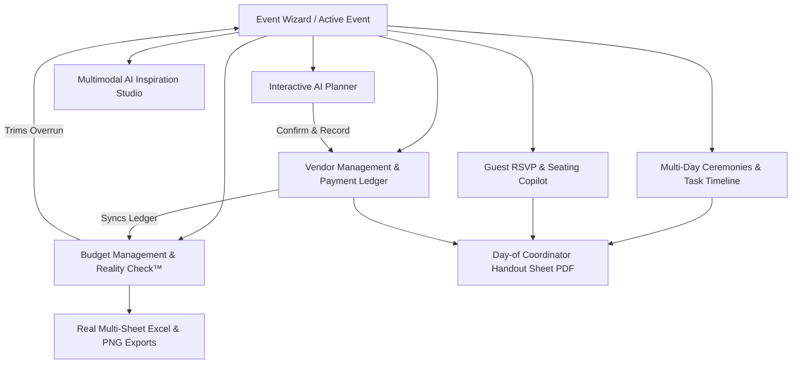
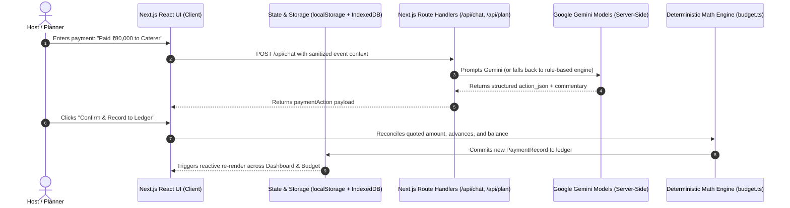

# UtsavAI — The Luxury AI Celebration Copilot

> **Every celebration, beautifully planned.**  
> *Built for Hack2Skill PromptWars Virtual Challenge 5: Celebration & Event Planner.*

[](https://nextjs.org/)
[](https://react.dev/)
[](https://www.typescriptlang.org/)
[](https://tailwindcss.com/)
[](https://ai.google.dev/)
[](https://vitest.dev/)
[](LICENSE)

---

## 1. Project Overview

### The Problem
Organizing a milestone celebration — whether a grand Indian wedding, a 30th birthday gala, a silver jubilee anniversary, or a community festival — is notoriously stressful. Hosts are forced to juggle:
- Fragmented communication across WhatsApp, phone calls, and messy spreadsheets.
- Vendor quotation uncertainty, where advance deposits, committed quotes, and cash settlement balances blur together.
- Inflexible budgets that fail to warn hosts when a single splurge (like an imported floral arch) pushes the overall event into debt.
- Cultural and multi-day logistical complexity (Haldi, Mehendi, Sangeet, Pheras) where dress codes, catering styles, and guest dietary preferences (Jain, Halal, Vegan) must be tracked accurately.

### The UtsavAI Solution
**UtsavAI** is an AI-powered celebration copilot that unites budgeting, vendor contracting, timeline coordination, guest hospitality, and visual styling into one connected masterplan. Built with an **Editorial Luxury** aesthetic (Midnight Plum, Champagne Lavender, Rose-Pink, and Cormorant Garamond typography), UtsavAI replaces chaotic planning with effortless clarity.

### Challenge 5 Alignment
UtsavAI directly addresses the **Hack2Skill PromptWars Virtual Challenge 5 (Celebration & Event Planner)** requirements by delivering:
- An uncapped, occasion-tailored celebration creation engine.
- A conversational AI planner with deterministic financial ledger reconciliation (preventing AI math hallucinations).
- Real-time Budget Reality Checks™ with automated, category-specific cost trimming alternatives.
- Multi-day Indian ceremony management and dietary-aware guest seating copilots.
- Production-ready exports (genuine `.xlsx` multi-sheet workbooks and printable Day-of Coordinator Handout PDFs).

---

## 2. Features and Functionality



### 1. Event Creation & Multi-Event Management
- **5-Step Celebration Wizard:** Choose between Wedding, Birthday, Anniversary, Community, or Custom Occasions.
- **Cultural & Ceremony Selection:** Supports specific Indian traditions (Sangeet, Haldi, Mehendi, Pheras, Reception).
- **Multi-Event Switching:** Seamlessly switch between multiple celebrations; deleting an event cleans associated data without leaving orphan records.
- **Reversible Demo Mode:** One-click "Load Demo Event" enables evaluators to explore a pre-populated 50-guest celebration with an explicit "Exit Demo" button to return to clean state.

### 2. Conversational AI Celebration Planner (`/planner`)
- **Event Context Awareness:** The copilot continuously ingests current budget status, committed vendors, paid ledger balances, and guest counts.
- **Natural Language Payment Recording:** Type *"I paid ₹80,000 advance to Royal Flavors Catering"* and the AI extracts the vendor, category, payment amount, and remaining payable balance.
- **Deterministic Action Cards:** Provides structured 1-click execution cards (*"Confirm & Record to Ledger"*, *"Add Expense"*, *"Add Task"*).

### 3. Budget Management & Budget Reality Check™ (`/budget`)
- **Three-Tier Financial Tracking:** Clear distinction between initial Estimated Amounts, Quoted Vendor Commitments, and Actual Disbursed Cash.
- **Budget Reality Check™:** Detects over-budget conditions in code and generates targeted, non-destructive category trimming proposals (e.g., streamline starter courses or optimize floral arrangements).
- **Allocation Builder Modal:** Set category-level target caps (Catering, Décor, Photography, Venue, Cake, Entertainment, Contingency Reserve).
- **Currency Support:** Defaults to Indian Rupee (`₹`, `INR`) with instant switching to USD, EUR, GBP, AED, and SGD.

### 4. Vendor Quotation & Payment Ledger Sync (`/vendors`)
- **Itemized Ledger:** Tracks vendor contact info, quoted commitments, paid advances, and remaining balances.
- **Authoritative Source:** The payment transaction ledger is the single source of truth; deletions and modifications immediately update vendor balances and budget totals.

### 5. Multi-Day Ceremony Itinerary & Task Timeline (`/timeline`)
- **Multi-Day Indian Ceremony Tab:** Schedule sub-events across multiple days with day-specific dress codes, catering styles, venue locations, and coordinator phone numbers.
- **Task Checklist Tab:** Phase-based milestone tracking (Planning, Bookings, Week-Of, Event Day) with priority filters and celebratory confetti on completion.

### 6. Guest RSVP & Table Seating Copilot (`/guests`)
- **Dietary Restriction Tracking:** Track dietary requirements including Jain, Vegetarian, Vegan, Non-Veg, Halal, and Gluten-Free.
- **AI Table Seating Copilot:** 1-click auto-seating groups guests by family, colleagues, and friends across numbered banquet tables.
- **Dual Visualizations:** Switch between clean itemized list view and interactive table cards.

### 7. Day-of Coordinator Handout Sheet
- **Printable Physical Handout:** Accessible via top action button on Dashboard, Timeline, and Vendors pages.
- **Coordinator Essentials:** Emergency contacts, ceremony milestones, confirmed dietary meal counts, and an itemized vendor settlement balance ledger with physical signature signoff blocks.

### 8. Multimodal AI Inspiration Studio (`/inspiration`)
- **Curated Reference Galleries:** Curated aesthetics for Royal Rajputana Mandaps, Romantic Ivory Arches, Milestone 30th Birthdays, and Neon Evening Galas.
- **AI Vision Analysis:** Upload venue or decor photographs; the vision model extracts dominant hex color palettes, floral styling, and computes exact banquet table and chair quantities based on your guest count.
- **IndexedDB Binary Storage:** Photos are compressed and stored locally in browser IndexedDB to prevent localStorage quota exhaustion.

### 9. Genuine Data Exports
- **Excel Export (`.xlsx`):** Generates authentic, multi-sheet formatted workbooks using SheetJS (Overview, Budget, Vendors, Tasks, and Payment Ledger).
- **PNG Chart Export:** Renders high-resolution 1200x630 branded chart graphics directly via HTML5 Canvas.

### 10. Theme System & Accessibility
- **Day-to-Night Themes:** Midnight Gala (Dark Mode default) and Ivory Celebration (Light Mode) via `next-themes`.
- **WCAG 2.2 AA Compliance:** High-contrast text, visible `:focus-visible` keyboard rings, and proper ARIA dialog semantics.

---

## 3. Technology Stack

| Layer | Technology | Version | Purpose in UtsavAI |
| :--- | :--- | :--- | :--- |
| **Framework** | [Next.js](https://nextjs.org/) | 16.4.2 | App Router architecture, Turbopack dev/build, server-side Route Handlers |
| **UI Library** | [React](https://react.dev/) | 19.3.0 | Modern React component model with hydration-safe store sync |
| **Language** | [TypeScript](https://www.typescriptlang.org/) | 5.x | Strict type safety across all event, budget, vendor, and guest models |
| **Styling** | [Tailwind CSS](https://tailwindcss.com/) | 4.x | Token-based theme system, responsive utilities, and custom animations |
| **AI SDK** | [@google/genai](https://www.npmjs.com/package/@google/genai) | 2.31.0 | Official Google GenAI SDK for Gemini 2.5 Flash / Pro and multimodal vision |
| **Validation** | [Zod](https://zod.dev/) | 4.6.7 | Runtime schema validation for API payloads, event records, and transactions |
| **Testing** | [Vitest](https://vitest.dev/) | 5.0.5 | Blazing fast automated unit and integration testing |
| **Charts** | [Recharts](https://recharts.org/) | 3.10.1 | Interactive SVG donut charts for category spend visualization |
| **Spreadsheets**| [SheetJS (xlsx)](https://sheetjs.com/) | 0.18.5 | Client-side generation of authentic multi-sheet `.xlsx` workbooks |
| **Icons** | [Lucide React](https://lucide.dev/) | 1.61.0 | Clean, accessible iconography |
| **Storage** | `localStorage` + IndexedDB | Native | Dual-layer persistence: lightweight JSON state + binary photo storage |

---

## 4. Architecture and Data Flow



### Deterministic Math vs. AI Output
UtsavAI enforces a strict architectural boundary between AI suggestions and financial math:
- **AI's Role:** Creative recommendations, cultural guidance, schedule ideas, vision interpretation, and natural language intent parsing.
- **Code's Role:** All financial totals, allocations, percentage splits, remaining balances, and ledger settlements are computed deterministically in `src/lib/budget.ts`. AI is never allowed to hallucinate financial totals.

---

## 5. Project Folder Structure

```
Utsav AI/
├── .env.example                  # Environment template with model routing
├── package.json                  # Dependencies, build scripts & test commands
├── tsconfig.json                 # Strict TypeScript configuration
├── vitest.config.ts              # Vitest test runner configuration
├── DEMO_STORYBOARD.md            # Challenge 5 video walkthrough storyboard
├── DEMO_NARRATION.md             # Complete spoken voiceover script
├── DEMO_RECORDING_CHECKLIST.md   # Step-by-step recording pre-flight guide
├── DEMO_CAPTIONS.md              # Lower-third overlays & subtitle tracks
└── src/
    ├── app/                      # Next.js App Router routes
    │   ├── layout.tsx            # Root layout with ThemeProvider & AppProvider
    │   ├── page.tsx              # Luxury landing page with video hero & atmospheres
    │   ├── globals.css           # Semantic color tokens, focus-visible & reduced motion
    │   ├── dashboard/page.tsx    # Executive celebration overview & quick launchers
    │   ├── wizard/page.tsx       # 5-step occasion-tailored event wizard
    │   ├── planner/page.tsx      # Conversational AI planner & payment action cards
    │   ├── budget/page.tsx       # Budget Reality Check™, allocations & exports
    │   ├── vendors/page.tsx      # Vendor contracts, balances & payment ledger
    │   ├── timeline/page.tsx     # Multi-day ceremonies & milestone checklist
    │   ├── guests/page.tsx       # Guest RSVP copilot & AI table seating layout
    │   ├── inspiration/page.tsx  # Multimodal AI vision studio & reference gallery
    │   ├── settings/page.tsx     # Preferences, currency selector & JSON backup
    │   └── api/                  # Secure server-side Route Handlers
    │       ├── chat/route.ts     # Ingests chat, extracts payments & allocates budget
    │       ├── plan/route.ts     # Generates structured masterplans (Zod-validated)
    │       └── analyze-image/    # Multimodal photo analysis & guest table math
    ├── components/               # Reusable UI components
    │   ├── app-shell.tsx         # Unified desktop sidebar & mobile navigation shell
    │   ├── coordinator-handout-modal.tsx # Printable day-of coordinator PDF sheet
    │   ├── navigation.tsx        # Responsive navigation with active route highlights
    │   ├── theme-toggle.tsx      # Accessible hydration-safe light/dark toggle
    │   ├── video-hero.tsx        # Cinematic video background with motion guards
    │   └── currency-selector.tsx # Compact multi-currency switcher
    ├── contexts/
    │   └── app-context.tsx       # Authoritative React Context & business logic
    ├── lib/                      # Core business logic & services
    │   ├── budget.ts             # Deterministic budget calculation & Reality Check™
    │   ├── storage.ts            # Versioned storage service & quota mitigation
    │   ├── image-db.ts           # IndexedDB binary photo store & compression
    │   ├── export.ts             # SheetJS Excel (.xlsx) & HTML5 Canvas PNG exports
    │   ├── utils.ts              # Indian Rupee formatting, dates & category constants
    │   ├── demo-data.ts          # Reversible sample event data
    │   └── __tests__/            # Automated Vitest test suites
    │       ├── budget.test.ts    # Financial calculation tests
    │       ├── utils.test.ts     # Currency and formatting tests
    │       └── validation.test.ts# Zod data model schema tests
    └── types/
        └── index.ts              # Authoritative TypeScript domain definitions
```

---

## 6. Prerequisites and Local Setup

### Prerequisites
- **Node.js:** v18.17.0+ or v20.x (LTS recommended)
- **Package Manager:** `npm` (v9+) or `pnpm`

### Step 1: Clone or Navigate
```bash
cd "Utsav AI"
```

### Step 2: Install Dependencies
```bash
npm install
```

### Step 3: Configure Environment Variables
Copy the provided `.env.example` file to `.env.local`:
```bash
cp .env.example .env.local
```

Edit `.env.local` to configure your Google Gemini API key:
```env
GEMINI_API_KEY=your_actual_gemini_api_key_here
GEMINI_FAST_MODEL=gemini-2.5-flash
GEMINI_PRO_MODEL=gemini-2.5-pro
GEMINI_VISION_MODEL=gemini-2.5-flash
```

> **Note on Resilient Fallback:** If `GEMINI_API_KEY` is omitted, UtsavAI transparently operates in intelligent rule-based mode. All plans, chat prompts, and budget allocations generate mathematically accurate celebration masterplans without throwing runtime errors.

### Step 4: Run the Development Server
```bash
npm run dev
```
Open **[http://localhost:3000](http://localhost:3000)** in your browser.

### Step 5: Execute Automated Tests
```bash
npm run test
```

### Step 6: Run Production Build
```bash
npm run build
npm run start
```

---

## 7. Environment Variables & Model Configuration

| Variable Name | Purpose | Required? | Default / Example Value |
| :--- | :--- | :--- | :--- |
| `GEMINI_API_KEY` | Google GenAI API key for Gemini models | Optional (Fallback active) | `AIzaSy...` (Get from [Google AI Studio](https://aistudio.google.com/)) |
| `GEMINI_FAST_MODEL` | Fast model for interactive chat & quick responses | Optional | `gemini-2.5-flash` |
| `GEMINI_PRO_MODEL` | Deep reasoning model for masterplan generation | Optional | `gemini-2.5-pro` |
| `GEMINI_VISION_MODEL` | Multimodal model for decor & photo analysis | Optional | `gemini-2.5-flash` |

*Security Warning:* Never commit `.env.local` or expose `GEMINI_API_KEY` to client-side bundles. All Gemini calls in UtsavAI execute strictly within server-side Route Handlers.

---

## 8. Data Storage & Persistence

UtsavAI implements a dual-layer, browser-local persistence architecture:

1. **Lightweight JSON Store (`localStorage`):**
   - Key: `utsavai_v1_store` (Version 3).
   - Stores metadata, events, tasks, vendors, payment records, and guest lists (< 100 KB).
   - Sanitization filters prevent large base64 strings from polluting the store.
2. **Binary Media Store (IndexedDB):**
   - Database: `utsavai_media_db`.
   - Stores compressed Blobs for uploaded inspiration photos, preserving browser storage limits.
3. **Data Boundary & Migration Notice:**
   - User data remains strictly local to the user's browser. It does not automatically sync across separate devices without using the **JSON Backup / Restore** feature in `/settings`.
   - Clearing browser site data will reset local celebrations unless exported via the Settings page.

---

## 9. Deployment Guide (Render Web Service)

To deploy UtsavAI for public demonstration on [Render](https://render.com/):

### Step 1: Push Repository to GitHub
Ensure your repository is pushed to GitHub with `.env.local` excluded by `.gitignore`.

### Step 2: Create a Render Web Service
1. Log in to [Render Dashboard](https://dashboard.render.com/) and click **New +** → **Web Service**.
2. Connect your GitHub repository.
3. Configure the service settings:
   - **Name:** `utsav-ai`
   - **Environment:** `Node`
   - **Region:** Any close region (e.g., Singapore, Frankfurt, Oregon)
   - **Branch:** `main`
   - **Build Command:** `npm install && npm run build`
   - **Start Command:** `npm run start`
   - **Plan:** Free or Starter

### Step 3: Configure Environment Variables
Under the **Environment** tab on Render, add:
- `GEMINI_API_KEY` = `your_google_gemini_api_key`
- `NODE_VERSION` = `20.10.0`
- `GEMINI_FAST_MODEL` = `gemini-2.5-flash`
- `GEMINI_PRO_MODEL` = `gemini-2.5-pro`
- `GEMINI_VISION_MODEL` = `gemini-2.5-flash`

### Step 4: Verify Deployment
1. Once deployed, open your live Render URL (e.g., `https://utsav-ai.onrender.com`).
2. Test the core routes: `/`, `/dashboard`, `/wizard`, `/planner`, `/budget`, `/vendors`, `/timeline`, `/guests`, `/inspiration`.
3. Verify that `/broadcast` returns a clean 404.

---

## 10. Testing & Quality Verification

UtsavAI includes automated test coverage implemented with Vitest:

### Running Test Suite
```bash
npm run test
```

### Test Coverage Highlights
- **Financial Engine (`src/lib/__tests__/budget.test.ts`):**
  - Zero-expense handling and negative budget guards.
  - Quoted commitments vs. estimated amounts priority.
  - Over-budget detection and exact rupee deficit calculation.
  - Contingency reserve deduction from unallocated balances.
  - Budget Reality Check™ category trimming algorithms.
- **Utilities & Formatting (`src/lib/__tests__/utils.test.ts`):**
  - Indian Rupee (`₹1,50,000`) number system formatting.
  - USD, EUR, and invalid monetary value fallbacks.
  - Human date formatting and deadline countdown logic.
  - Unique ID generation and category constants completeness.
- **Validation Schemas (`src/lib/__tests__/validation.test.ts`):**
  - Strict Zod schema validation for Event records, Payment transactions, and Guest RSVP lists.
  - Rejection of negative amounts, malformed dates, and invalid dietary options.

---

## 11. Security and Accessibility

### Security Implementations
- **Server-Side API Route Protection:** Rate-limited to prevent abuse (20 req/min for chat, 15 req/min for image analysis).
- **Payload Constraints:** 512 KB request limit for chat prompts; 10 MB limit for multimodal images.
- **MIME Type Guards:** Validates image file formats before invoking Gemini Vision.
- **Sanitized Markdown Rendering:** AI responses are rendered safely without arbitrary script execution.

### Accessibility Standards (WCAG 2.2 Level AA)
- **Focus Rings:** Visible, high-contrast `:focus-visible` outlines across all buttons, inputs, and interactive controls.
- **Semantic ARIA Roles:** Modals implement `role="dialog"`, `aria-modal="true"`, and `aria-labelledby` headings.
- **Motion Sensitivity:** Enforces `@media (prefers-reduced-motion: reduce)` globally, disabling rapid transitions and pausing background videos.
- **Color Contrast:** Deep Midnight Plum (`#0C0914`) background with high-contrast text exceeds WCAG 4.5:1 contrast requirements.

---

## 12. License & Acknowledgments

This project was developed for the **Hack2Skill PromptWars Virtual Challenge 5**.

- **Design Inception:** Inspired by the visual elegance of Indian weddings and modern SaaS productivity tools.
- **AI Intelligence:** Powered by Google Gemini 2.5 Flash & Pro via the `@google/genai` SDK.
- **License:** Released under the [MIT License](LICENSE).
